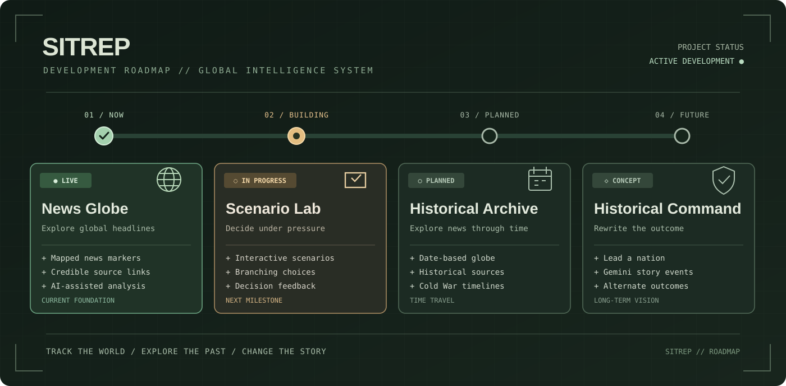

# SitRep

**Global news. On the map.**

SitRep is an interactive globe for exploring the latest available headlines from established news publishers. It maps stories to their locations, uses Gemini to estimate sentiment and event severity when available, and includes a **Scenario Lab** for decision-based simulations.

## Features

- **News globe** — Explore geolocated headlines and open the original publisher reports.
- **AI-assisted analysis** — Gemini estimates story sentiment, severity, and location; a clearly labelled heuristic fallback is used when AI is unavailable.
- **Shared live feed** — RSS updates and analysis results are cached in Supabase and reused across visitors.
- **Scenario Lab** — A space for interactive, decision-based simulations *(in development)*.
- **News archive** — Persistently stores mapped stories for future exploration.

## Roadmap




## Tech stack

**TanStack Start** · **Supabase** · **Gemini** · **RSS** · **Vercel** · **Bun**

## Run locally

```bash
bun install
cp .env.example .env
bun run dev
```

Add your server-side credentials to `.env` (which is ignored by Git). Local development can show RSS headlines without Supabase; shared analysis caching and the persistent archive require it.

## Deploy independently

1. **Set up Supabase.** Create your own project and run these migrations in its SQL Editor, in order:
   - `supabase/migrations/20261116000000_sitrep_schema.sql`
   - `supabase/migrations/20261116000001_archive_assessments.sql`

   If your project already has the first schema, run only the second migration.

2. **Deploy to Vercel.** Import this repository and use `bun run build` as the build command.

3. **Set server environment variables** in Vercel:

   ```dotenv
   SUPABASE_URL=your_project_url
   SUPABASE_SECRET_KEY=your_sb_secret_key
   GEMINI_API_KEY=your_gemini_api_key
   ```

   Get the Gemini key from Google AI Studio. A legacy Supabase `service_role` key can instead be supplied as `SUPABASE_SERVICE_ROLE_KEY`. A publishable key is **not** sufficient for server-side archive writes. Never expose secrets with a `VITE_` prefix.

4. **Deploy.** The first visitor triggers a shared RSS refresh; subsequent visitors use the shared feed and cached analysis.

---

*SitRep links to publisher reporting. Headlines and summaries remain subject to the original publishers' terms.*
