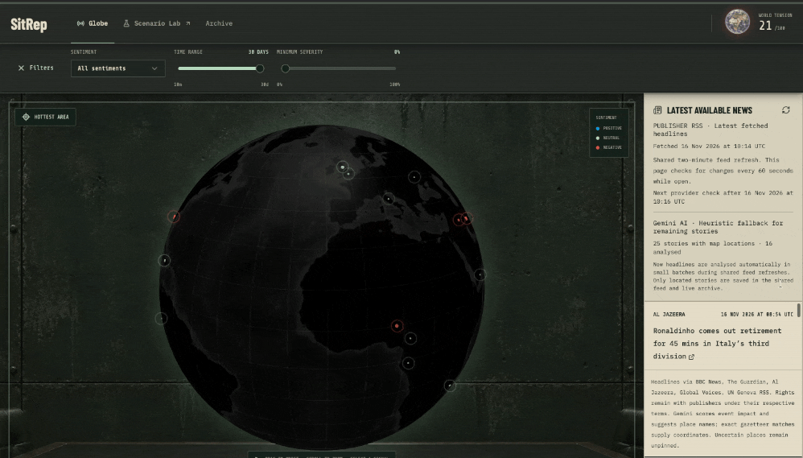
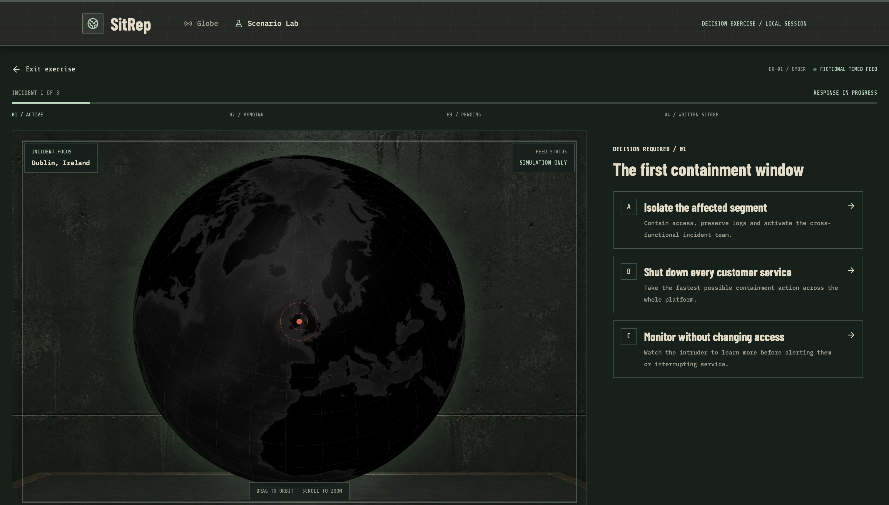

<h1 align="center">SitRep</h1>

<h3 align="center">Global news. On the map.</h3>

<p align="center">
  Explore the latest available headlines from established news publishers on an interactive 3D globe.
  Discover where stories happen, follow the original reporting, and explore AI-assisted event analysis.
</p>

<p align="center">
  
  
  
</p>

## Preview

### Live News Globe

<p align="center">
  
</p>

Explore global headlines using a 3D globe, map markers, news filters, and links to publisher reports.

### Scenario Lab

<p align="center">
  
</p>

Create and explore decision-based scenarios. **In development.**

## Features

- **Interactive news globe:** Browse headlines by geographic location and open the original publisher coverage.
- **AI-assisted analysis:** Gemini estimates event locations, sentiment, and severity when available, with a labelled heuristic fallback.
- **Shared news feed:** RSS refreshes and classification results are cached in Supabase for reuse across visitors.
- **News archive:** Stores mapped headlines for future exploration.
- **Scenario Lab:** Decision-based simulations and interactive stories *(in development)*.

## Roadmap

<p align="center">
  
</p>

**Planned:** Historical news exploration by date—including Cold War periods—and Gemini-driven alternate-history strategy scenarios where players make decisions as national leaders. Historical reporting and generated scenarios will be presented separately.

## Tech Stack

<p>
  
  
  
  
  
  
  
  
</p>

## Run Locally

```bash
bun install
cp .env.example .env
bun run dev
```

Add your own server-side credentials to `.env`. This file is ignored by Git. Local development can display RSS headlines without Supabase, but the shared analysis cache and persistent archive require a database.

## Independent Deployment

1. **Create a Supabase project.** Run these migrations in the Supabase SQL Editor, in order:
   - [`20261116000000_sitrep_schema.sql`](supabase/migrations/20261116000000_sitrep_schema.sql)
   - [`20261116000001_archive_assessments.sql`](supabase/migrations/20261116000001_archive_assessments.sql)

   Existing projects with the first migration applied only need the second migration.

2. **Import the repository into Vercel.** Use `bun run build` as the build command.

3. **Configure server environment variables:**

   ```dotenv
   SUPABASE_URL=your_project_url
   SUPABASE_SECRET_KEY=your_sb_secret_key
   GEMINI_API_KEY=your_gemini_api_key
   ```

   Set `SUPABASE_SECRET_KEY` to your project's `sb_secret_…` key. Alternatively, use a legacy service-role key as `SUPABASE_SERVICE_ROLE_KEY`. Supabase publishable keys cannot perform the server-only archive writes. **Never expose secrets with a `VITE_` prefix.**

4. **Deploy.** The first visitor triggers a shared RSS refresh; later visitors reuse the shared feed and cached classifications.

---

<p align="center"><sub>SitRep links to original publisher reporting. Headlines and summaries remain subject to their publishers' terms.</sub></p>
